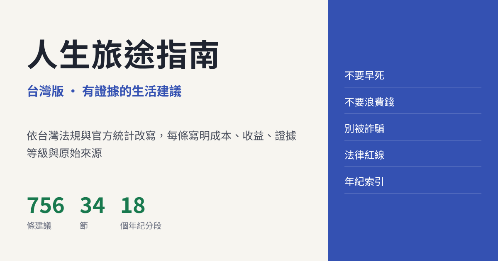

# 人生旅途指南（台灣版）

756 條有證據的生活建議，依台灣法規與官方統計改寫。 
每條寫明要花什麼、能換回什麼、證據有多硬，並附原始來源。

### [打開網頁版](https://ijoe8888.github.io/taiwan-life-guide/)

---

## 這是什麼

這是一份生活備選清單，內容包括：

- 怎麼活得久、少生病，出了意外先做什麼。
- 怎麼少花冤枉錢，哪些事會讓人被騙或吃上官司。
- 沒工作、沒錢的時候可以去領什麼。
- 開店、架網站要辦什麼。
- 戀愛、結婚、生小孩、出國、學技能、照顧長輩、辦後事。

全書 34 節。每條建議分成幾欄：

- **說人話**：一兩句話講完這條在說什麼。
- **成本**：要花的錢、時間和毅力。
- **收益**：能換回什麼，附研究數字或台灣官方統計。
- **證據等級**：A、B、C 三級，定義見下方「證據等級」。
- **來源**：可以點開的原始文獻、法條或官方資料。
- **時效標注**：和政策、法規有關的條目才有，寫明本條撰寫的日期，以及引用的政策是哪一天發布的。

不用全做。挑走一兩條，就算有用。

## 從哪裡來

本站改編自 [eternity4719](https://github.com/eternity4719) 的開源書[《高性价比人生指南》（HowToLiveBetter）](https://github.com/eternity4719/HowToLiveBetter)。原書以 CC BY 4.0 授權，內容的法律、健保、社保等制度部分是依中國大陸的規定寫的。本站同步到原書 commit `5f210ca`（2026-10-15），之後改寫成台灣版。

本站的改動由改編者負責，原作者沒有審閱，也不背書。

## 我改了什麼

1. **轉成繁體與台灣用語**，例如醫保改成健保、社保改成勞保。金額除非另外註明，都是新臺幣。
2. **制度全部換成台灣的。** 法律、健保、勞保、稅、租屋、買房、出國、留學等條目，依全國法規資料庫和主管機關公告重寫。
3. **引用台灣資料優先。** 能找到台灣研究或台灣官方統計的就用台灣的，例如衛福部、國健署、疾管署、勞動部、警政署、內政部。台灣查不到同類研究的，照實寫「台灣查無同類研究」，再改用國際研究。
4. **刪除中國大陸的資料與來源**，並在條目備註寫明刪了什麼。
5. **新增「年紀索引」。** 選性別和年紀之後，可以看到：
   - 台灣這個年紀最常見的死因；
   - 政府給你的免費篩檢和公費疫苗；
   - 法律上的年齡門檻；
   - 這個年紀最常被哪種詐騙騙；
   - 書裡跟這個年紀有關的條目。

   年紀分成 18 段：0–2、3–5、6–11、12–14、15–17、18–19、20–24、25–29、30–34、35–39、40–44、45–49、50–54、55–59、60–64、65–74、75–84、85 歲以上。
6. **新增台灣特有的條目**，包括：
   - 網購、假買家、假交友、色情應召、釣魚連結這五種近一年最常發生的詐騙；
   - 不動產詐騙；
   - 被騙到緬甸詐騙園區；
   - 認知作戰；
   - 假消息；
   - 跨境鎮壓。
7. **加上時效標注。** 政策可能會變，使用前請以主管機關最新公告為準。

## 怎麼用

**全書**

- 用上方搜尋框找關鍵字。
- 按「只看 A 級」，只留下證據最硬的條目。
- 按「只看說人話」，每條只剩一兩句重點，適合快速瀏覽。
- 用節號選單直接跳到某一節。

**年紀索引**

- 按上方的「年紀索引」，選男性或女性，再選年紀。
- 點清單裡的條目，會跳回全書的那一條。

**離線使用**

- 整本書是一個檔案。下載 `index.html` 之後，用瀏覽器打開，不用網路也能讀。

## 證據等級

| 等級 | 意思 |
| --- | --- |
| A | 有具體數字可查，出處是統合分析、大型追蹤研究或隨機試驗。法律、政策類條目的 A 級，指的是引到法條或官方文件原文。 |
| B | 有研究或官方資料支持，但說不出確切數字；或者只有小樣本、單一研究；或者主要依新聞報導。 |
| C | 經驗或公認做法，沒有直接的研究文獻。 |

A 級只代表「有具體數字、出處可以核對」，不代表那個數字一定是因果關係。

## 請注意

- 內容可能過時，也可能有錯。
- 真的要辦事、看病、打官司時，以主管機關、醫師和律師的說法為準。
- 本站不是醫療、法律或投資建議。
- 發現寫錯了，歡迎到 [Issues](https://github.com/ijoe8888/taiwan-life-guide/issues) 回報，請附上正確的來源。

## 授權

- 正文依 [CC BY 4.0](LICENSE) 授權。轉載或再改編時，請同時註明：
  - 原書：《高性价比人生指南》，eternity4719
  - 本台灣版
- 網頁程式碼依 [MIT](LICENSE-CODE) 授權。

## 製作方式

查證資料和改寫時使用 AI 工具（Claude）協助，所有條目都附來源，可以自行點開核對。
